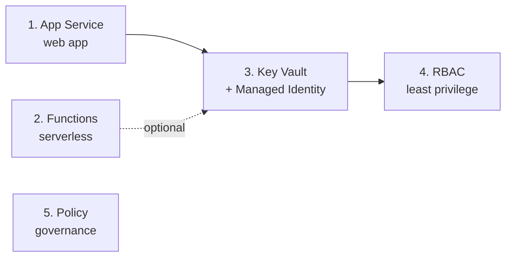

# ☁️ Azure PaaS & Security Hands-on Lab

🇺🇸 English | [🇰🇷 한국어](README.md)

[](https://codespaces.new/Taeyangmoon/azure-paas-lab)
[](LICENSE)

Learn how to run apps **without managing servers (PaaS)** and **securely** in five short labs.
Nothing to install: open **GitHub Codespaces** in your browser and paste the commands into the terminal.

## 🎯 What will you learn?

| # | Lab | Key question | Time |
|---|-----|--------------|------|
| 1 | [App Service: deploy a sample web app](labs/01-app-service/README.en.md) | What does PaaS manage for you that you'd manage yourself on a VM? | 20 min |
| 2 | [Functions: HTTP-triggered function](labs/02-functions/README.en.md) | How little code and cost does serverless need? | 20–30 min |
| 3 | [Key Vault + Managed Identity](labs/03-key-vault/README.en.md) | How can an app read secrets **without credentials in code**? | 25–35 min |
| 4 | [RBAC & Microsoft Entra ID](labs/04-rbac-entra/README.en.md) | Who can do what, and where? (least privilege) | 25 min |
| 5 | [Azure Policy & tag governance](labs/05-policy-governance/README.en.md) | How do you **automatically block** non-compliant resources? | 20 min |

> Everything you need is in this repository. Do **1 → 2 → 3 → 4** in order (labs 3 and 4 reuse the web app from lab 1; lab 2 is only used in an optional step of lab 3). **Lab 5 is standalone.**



## ✅ Prerequisites

1. An **Azure subscription** – create a [free account](https://azure.microsoft.com/free/) (includes credits) if needed.
   - You need **Owner** (or Contributor + User Access Administrator). Labs 4 and 5 create role and policy assignments, so use a *personal sandbox subscription, not a corporate one*.
   - Labs 2 and 3 use managed identities and Private Endpoints with **public access and storage key authentication disabled**, including in managed subscriptions enforcing those restrictions. VNet/Private Endpoint creation and App Service B1 must be allowed. No policies are disabled or bypassed.
2. A **GitHub account** (for Codespaces).

## 🚀 Getting started

1. Click **Open in GitHub Codespaces** above, or `Code` → `Codespaces` → `Create codespace` in this repo.
2. Sign in to Azure in the terminal (the **device-code flow** works best in Codespaces):

   ```bash
   az login --use-device-code
   ```

3. Pre-flight check + resource provider registration (once; may take a few minutes):

   ```bash
   bash scripts/00-setup.sh
   ```

4. Continue with [Lab 1](labs/01-app-service/README.en.md). 🎉

Every lab starts with `source scripts/env.sh`. It adds a **random suffix to resource names** (e.g. `app-paaslab-x7k2qa`) so names don't collide with other people's. Run it again in any new terminal.

## 💸 Cost & cleanup

- Lab 1 uses free App Service `F1`; Lab 2 uses usage-based Functions Flex Consumption.
- **Lab 3 upgrades to paid B1**, explicitly acknowledged with `--allow-paid`. **Private Endpoints in Labs 2 and 3 incur hourly cost**, and Key Vault is billed per operation. Policy/RBAC are free.
- **Always clean up** after the labs. One command deletes everything:

  ```bash
  bash scripts/cleanup.sh
  ```

- If the free `F1` plan hits a quota error, run `export WEBAPP_SKU=B1` and retry (B1 bills a small hourly rate, so cleanup matters more).
- Stop or delete the Codespace itself when you're not using it.

## 📁 Repository layout

```text
.devcontainer/      Codespaces environment (Python 3.12, Azure CLI, Functions Core Tools)
scripts/            Shared variables, pre-flight, automated lab 2/3 setup, and cleanup
src/webapp/         Sample Flask web app for labs 1 & 3
src/function/       Sample Azure Functions app (Python v2) for labs 2 & 3
labs/               Lab guides (Korean README.md / English README.en.md)
tests/              Regression tests for app errors, RBAC retries, and cleanup
```

## 🧪 Local regression checks

Run in the Python 3.12 Codespaces environment (outside Codespaces, install dependencies from both `requirements.txt` files first).

```bash
python -m unittest discover -s tests -v
for script in scripts/*.sh; do bash -n "$script" || exit; done
```

GitHub Actions runs the same checks without Azure credentials or resources. These checks do not replace executing the real Azure labs.

## 🔐 Security principles in this lab

- **No passwords or keys** in code or the repo (Lab 3).
- Grant **least privilege** at the narrowest scope (Lab 4).
- Enforce rules with **policy**, not memory (Lab 5).
- The web app is deployed HTTPS-only, TLS 1.2+, FTP disabled (Lab 1).
- Storage and Key Vault disable public access, and storage uses managed identity instead of keys. Networking is scripted so the exercises focus on requests, identities, and permissions (Labs 2 and 3).

## 📄 License

[MIT](LICENSE) © 2026 Taeyang Moon
