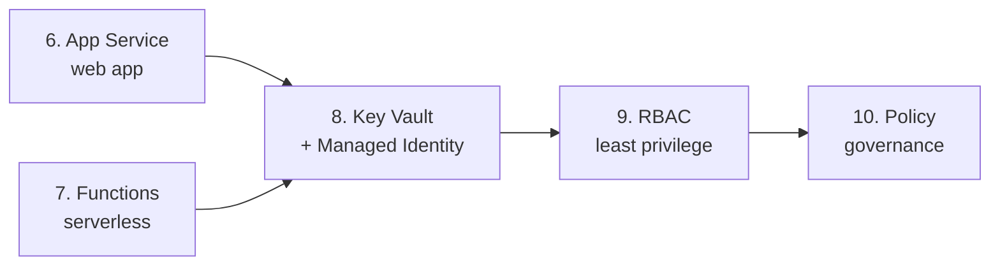

# ☁️ Azure PaaS & Security Hands-on Lab

🇺🇸 English | [🇰🇷 한국어](README.md)

[](https://codespaces.new/Taeyangmoon/azure-paas-lab)
[](LICENSE)

Learn how to run apps **without managing servers (PaaS)** and **securely** in five short labs.
Nothing to install: open **GitHub Codespaces** in your browser and paste the commands into the terminal.

## 🎯 What will you learn?

| # | Lab | Key question | Time |
|---|-----|--------------|------|
| 6 | [App Service: deploy a sample web app](labs/06-app-service/README.en.md) | What does PaaS manage for you that you'd manage yourself on a VM? | 20 min |
| 7 | [Functions: HTTP-triggered function](labs/07-functions/README.en.md) | How little code and cost does serverless need? | 20 min |
| 8 | [Key Vault + Managed Identity](labs/08-key-vault/README.en.md) | How can an app read secrets **without credentials in code**? | 25 min |
| 9 | [RBAC & Microsoft Entra ID](labs/09-rbac-entra/README.en.md) | Who can do what, and where? (least privilege) | 25 min |
| 10 | [Azure Policy & tag governance](labs/10-policy-governance/README.en.md) | How do you **automatically block** non-compliant resources? | 20 min |

> Lab numbers follow the wider Azure curriculum. Do **6 → 7 → 8 → 9** in order (8 and 9 reuse the web app from lab 6). **Lab 10 is standalone.**



## ✅ Prerequisites

1. An **Azure subscription** – create a [free account](https://azure.microsoft.com/free/) (includes credits) if needed.
   - You need **Owner** (or Contributor + User Access Administrator). Labs 9 and 10 create role and policy assignments, so use a *personal sandbox subscription, not a corporate one*.
2. A **GitHub account** (for Codespaces).

## 🚀 Getting started

1. Click **Open in GitHub Codespaces** above, or `Code` → `Codespaces` → `Create codespace` in this repo.
2. Sign in to Azure in the terminal (the **device-code flow** works best in Codespaces):

   ```bash
   az login --use-device-code
   ```

3. Pre-flight check + resource provider registration (once; may take a few minutes):

   ```bash
   bash scripts/00-setup.sh
   ```

4. Continue with [Lab 6](labs/06-app-service/README.en.md). 🎉

Every lab starts with `source scripts/env.sh`. It adds a **random suffix to resource names** (e.g. `app-paaslab-x7k2qa`) so names don't collide with other people's. Run it again in any new terminal.

## 💸 Cost & cleanup

- Defaults favor **free / pay-per-use**: App Service `F1` (free), Functions Flex Consumption (usage-based), Key Vault (per operation), Policy/RBAC (free).
- **Always clean up** after the labs. One command deletes everything:

  ```bash
  bash scripts/cleanup.sh
  ```

- If the free `F1` plan hits a quota error, run `export WEBAPP_SKU=B1` and retry (B1 bills a small hourly rate, so cleanup matters more).
- Stop or delete the Codespace itself when you're not using it.

## 📁 Repository layout

```text
.devcontainer/      Codespaces environment (Python 3.12, Azure CLI, Functions Core Tools)
scripts/            env.sh (shared variables), 00-setup.sh (pre-flight), cleanup.sh (delete all)
src/webapp/         Sample Flask web app for labs 6 & 8
src/function/       Sample Azure Functions app (Python v2) for labs 7 & 8
labs/               Lab guides (Korean README.md / English README.en.md)
```

## 🔐 Security principles in this lab

- **No passwords or keys** in code or the repo (Lab 8).
- Grant **least privilege** at the narrowest scope (Lab 9).
- Enforce rules with **policy**, not memory (Lab 10).
- The web app is deployed HTTPS-only, TLS 1.2+, FTP disabled (Lab 6).

## 📄 License

[MIT](LICENSE) © 2026 Taeyang Moon
