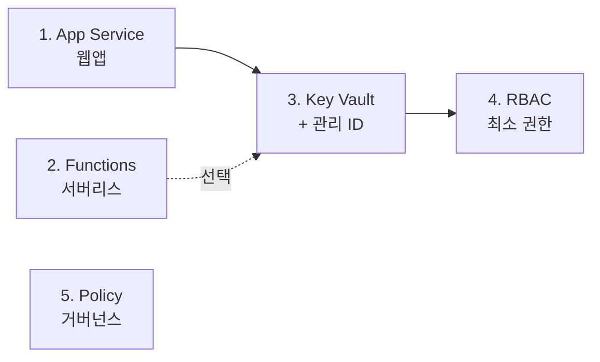

# ☁️ Azure PaaS & 보안 핸즈온 랩

[🇺🇸 English](README.en.md) | 🇰🇷 한국어

[](https://codespaces.new/Taeyangmoon/azure-paas-lab)
[](LICENSE)

**서버를 직접 관리하지 않고(PaaS) 안전하게(보안) 앱을 운영하는 방법**을 5개의 짧은 실습으로 배웁니다.
설치할 것은 없습니다. 브라우저에서 **GitHub Codespaces**를 열고 터미널에 명령어를 붙여 넣으면 됩니다.

## 🎯 무엇을 배우나요?

| # | 실습 | 핵심 질문 | 시간 |
|---|------|-----------|------|
| 1 | [App Service: 샘플 웹앱 배포](labs/01-app-service/README.md) | VM이라면 내가 해야 했을 일을 PaaS가 대신 해 주는 것은? | 20분 |
| 2 | [Functions: HTTP 트리거 함수](labs/02-functions/README.md) | 서버리스는 코드를 얼마나 짧게, 비용을 얼마나 적게 만들까? | 20분 |
| 3 | [Key Vault + 관리 ID](labs/03-key-vault/README.md) | 비밀번호를 **코드에 넣지 않고** 앱이 비밀을 읽으려면? | 25분 |
| 4 | [RBAC & Microsoft Entra ID](labs/04-rbac-entra/README.md) | "누가, 무엇을, 어디까지" 할 수 있게 할까? (최소 권한) | 25분 |
| 5 | [Azure Policy & 태그 거버넌스](labs/05-policy-governance/README.md) | 규칙을 어긴 리소스 생성을 **자동으로 막으려면?** | 20분 |

> 이 저장소만으로 모든 실습을 끝낼 수 있습니다. **1 → 2 → 3 → 4** 순서로 진행하세요(3, 4는 1번에서 만든 웹앱을 이어서 사용하고, 2번은 3번의 선택 단계에서만 쓰입니다). **5번은 독립적**입니다.



## ✅ 준비물

1. **Azure 구독** – 없다면 [무료 계정](https://azure.microsoft.com/free/)(크레딧 제공)을 만드세요.
   - 구독에서 **Owner**(또는 Contributor + User Access Administrator) 권한이 필요합니다. 실습 4·5는 역할 할당/정책 할당을 하므로 *회사 구독이 아닌 개인 실습용 구독*을 권장합니다.
2. **GitHub 계정** (Codespaces 사용)

## 🚀 시작하기

1. 위의 **Open in GitHub Codespaces** 버튼을 누르거나, 이 저장소에서 `Code` → `Codespaces` → `Create codespace`.
2. 터미널에서 Azure에 로그인합니다. (Codespaces에서는 **디바이스 코드 방식**이 가장 잘 동작합니다.)

   ```bash
   az login --use-device-code
   ```

3. 사전 점검 + 리소스 공급자 등록 (처음 한 번, 몇 분 걸릴 수 있어요):

   ```bash
   bash scripts/00-setup.sh
   ```

4. [실습 1](labs/01-app-service/README.md)로 이동하세요. 🎉

모든 실습은 `source scripts/env.sh` 로 시작합니다. 이 스크립트가 **리소스 이름에 무작위 접미사**를 붙여 (예: `app-paaslab-x7k2qa`) 다른 사람과 이름이 겹치지 않게 해 줍니다. 새 터미널을 열면 다시 한 번 실행하세요.

## 💸 비용과 정리

- 기본 설정은 **무료/종량제 위주**입니다: App Service `F1`(무료), Functions Flex Consumption(호출량 기반), Key Vault(요청당 과금), Policy/RBAC(무료).
- 실습 후에는 **반드시 정리**하세요. 한 번에 모두 삭제합니다.

  ```bash
  bash scripts/cleanup.sh
  ```

- 무료 `F1` 요금제 할당량 오류가 나면 `export WEBAPP_SKU=B1` 후 다시 시도하세요(B1은 시간당 소액 과금되므로 정리가 더 중요합니다).
- Codespace 자체도 사용하지 않을 때는 중지/삭제해 주세요.

## 📁 저장소 구조

```text
.devcontainer/      Codespaces 환경 (Python 3.12, Azure CLI, Functions Core Tools)
scripts/            env.sh(공통 변수), 00-setup.sh(사전 점검), cleanup.sh(전체 삭제)
src/webapp/         실습 1·3 샘플 Flask 웹앱
src/function/       실습 2·3 샘플 Azure Functions (Python v2)
labs/               실습 문서 (한국어 README.md / English README.en.md)
```

## 🔐 이 랩의 보안 원칙

- 코드와 저장소에 **비밀번호·키를 넣지 않습니다** (실습 3).
- **최소 권한**만 부여하고, 범위를 좁게 잡습니다 (실습 4).
- 규칙은 사람의 기억이 아니라 **정책**으로 강제합니다 (실습 5).
- 웹앱은 HTTPS 전용 / TLS 1.2 이상 / FTP 비활성으로 배포합니다 (실습 1).

## 📄 라이선스

[MIT](LICENSE) © 2026 Taeyang Moon
