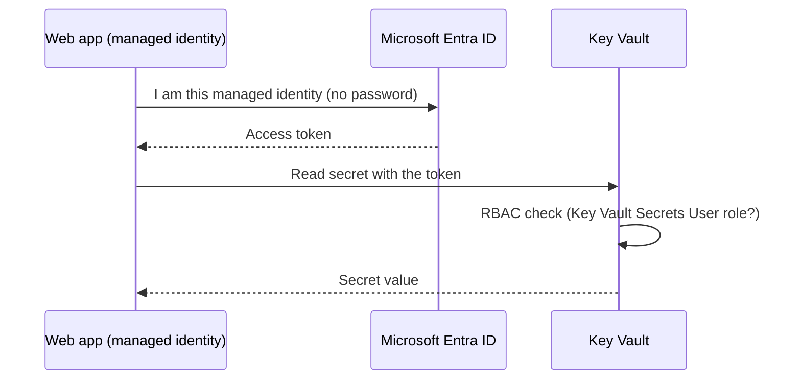

# Lab 3. Azure Key Vault + Managed Identity

🇺🇸 English | [🇰🇷 한국어](README.md) | [← Home](../../README.en.md) | [← Lab 2](../02-functions/README.en.md) | [Next: Lab 4 →](../04-rbac-entra/README.en.md)

⏱ 25–35 min · 💸 Hourly B1 + Private Endpoint cost · 🎯 **Internalize "never put credentials in code" by doing it.**
📌 Prerequisite: [Lab 1](../01-app-service/README.en.md) completed (web app required)

## Concept first

Passwords in code, config files or Git eventually leak. The fix combines two things:

- **Key Vault**: a vault for secrets, keys and certificates, with access logging.
- **Managed identity**: a **Microsoft Entra ID identity** attached to an Azure resource (web app, etc.). It has no password; Azure issues and rotates tokens for you.
- **Private Endpoint**: keeps the network path to secrets inside a VNet. Both **network access** and **RBAC permission** are required to read a secret.



You'll try **both ways** an app can read a secret:

| Method | Code change | Notes |
|--------|-------------|-------|
| A. **Key Vault reference** (app setting) | None (reads an env var) | Easiest; picks up secret changes automatically |
| B. **SDK + `DefaultAzureCredential`** | Key Vault client code | Full control; same code locally (`az login`) and on Azure (managed identity) |

## 1. Prepare — one command

```bash
bash scripts/03-key-vault.sh --allow-paid
```

`--allow-paid` acknowledges paid resources. The script upgrades F1 to **B1 for VNet integration**, then prepares a private Key Vault, Private DNS/Private Endpoint, managed identity, and read role. It does not relax organization policies or public-access settings.

```text
My HTTPS request → web app(B1) → VNet → Private Endpoint → Key Vault(public access Disabled)
                            └─ managed identity + Key Vault Secrets User ─┘
```

The script stores the public demo value `my-super-secret-value` using the **ARM management plane**. Never put real passwords in code or this command. Data-plane reads still need separate network access and RBAC permission.

## 2. Verify identity and least privilege

```bash
source scripts/env.sh
KV_ID=$(az keyvault show -g $RG -n $KV --query id -o tsv)
PRINCIPAL_ID=$(az webapp identity show -g $RG -n $WEBAPP --query principalId -o tsv)
az keyvault show -g $RG -n $KV --query properties.publicNetworkAccess -o tsv
az webapp show -g $RG -n $WEBAPP --query virtualNetworkSubnetId -o tsv
az role assignment list --scope $KV_ID \
  --query "[?principalId=='$PRINCIPAL_ID'].roleDefinitionName" -o tsv
```

Expect `Disabled`, a subnet ID, and `Key Vault Secrets User`. The app gets **read access only at vault scope**, not write/delete or subscription-wide permissions.

## 3. Method A: Key Vault reference (no SDK call)

The script sets `@Microsoft.KeyVault(VaultName=...;SecretName=demo-secret)` in app settings. The platform fetches it using managed identity and injects it as an environment variable.

The script waits for HTTP startup. You may see `unresolved` during role/DNS propagation; retry in 1-2 minutes. The first SDK request can be slower while obtaining a token.

```bash
URL="https://$(az webapp show -g $RG -n $WEBAPP --query defaultHostName -o tsv)"
curl -i $URL/secret/reference
# {"secret":"my******************* (length=21)","status":"ok"}
```

This route in `app.py` only reads `SECRET_FROM_REFERENCE`; it doesn't call the Key Vault SDK. The response masks the value instead of exposing the original secret.

> In the portal: web app → **Environment variables** → a **Key Vault reference ✔** next to `SECRET_FROM_REFERENCE`.

## 4. Method B: SDK + managed identity

```bash
curl -i $URL/secret/sdk
```

Core code (`src/webapp/app.py`):

```python
client = SecretClient(vault_url=vault_url, credential=DefaultAzureCredential())
secret = client.get_secret(name)
```

HTTP 200 with the masked secret proves **managed-identity authentication + RBAC permission + the private network path**. `DefaultAzureCredential` selects managed identity in this web app.

> Local/Codespaces is outside this VNet, so a direct SDK or `az keyvault secret show` request returns `Forbidden` as expected. Do not enable public access; test through the deployed web app. Owner's management permissions also don't automatically grant data-plane secret reads.

## 5. What if we remove the permission? 🔬

```bash
az role assignment delete --assignee $PRINCIPAL_ID --role "Key Vault Secrets User" --scope $KV_ID
```

After propagation, `curl -i $URL/secret/sdk` returns HTTP 403: **the network is unchanged, but removing permission still denies access**. RBAC caching means this isn't immediate. App-setting references are cached too, so use the SDK route for this experiment. Restore the role afterwards for Lab 4:

```bash
az role assignment create --assignee-object-id $PRINCIPAL_ID --assignee-principal-type ServicePrincipal \
  --role "Key Vault Secrets User" --scope $KV_ID -o none
```

## 6. (Optional) Do the same for the function app — if you completed Lab 2

```bash
FUNC_PID=$(az functionapp identity assign -g $RG -n $FUNCAPP --query principalId -o tsv)
az role assignment create --assignee-object-id $FUNC_PID --assignee-principal-type ServicePrincipal \
  --role "Key Vault Secrets User" --scope $KV_ID -o none
az functionapp config appsettings set -g $RG -n $FUNCAPP -o none --settings \
  "SECRET_FROM_REFERENCE=@Microsoft.KeyVault(VaultName=$KV;SecretName=demo-secret)"
# after 1-2 minutes
KEY=$(az functionapp keys list -g $RG -n $FUNCAPP --query functionKeys.default -o tsv)
HOST=$(az functionapp show -g $RG -n $FUNCAPP --query "properties.defaultHostName || defaultHostName" -o tsv)
curl -i "https://$HOST/api/secret" -H "x-functions-key: $KEY"
unset KEY
```

Like the web app, the function returns HTTP 404 for a missing setting, HTTP 502 for an unresolved reference, and HTTP 200 on success.

## ❓ Quiz

1. Where did **you type a password/key** in this lab? (Not for the managed identity!)
2. Why couldn't an Owner read the secret? (management plane vs data plane)
3. If the secret changes often, which method is more convenient, A or B?

## 🛠 Troubleshooting

| Symptom | Fix |
|---------|-----|
| Script run without `--allow-paid` | Review B1/Private Endpoint costs and run with that option |
| `/secret/reference` says `unresolved` | Check identity and role (step 2) → `az webapp restart` → wait 2 minutes. Check the reference status under Environment variables in the portal |
| Web app `/secret/sdk` says `ForbiddenByRbac` | Check the managed identity's read role at vault scope and wait for propagation |
| Web app `/secret/sdk` says `ForbiddenByConnection` | Check VNet/DNS/Private Endpoint setup in `bash scripts/03-key-vault.sh --allow-paid`. This denial is expected for direct requests from the local terminal |
| Key Vault name conflict / deleted name | `az keyvault purge --name $KV` or use a new suffix |

> ⚠️ Network restrictions are already enabled. In production also enable **purge protection**; only that protection is omitted here for cleanup. B1 and Private Endpoints incur cost even while idle: always clean up afterwards.

➡️ Next: [Lab 4. RBAC & Microsoft Entra ID](../04-rbac-entra/README.en.md)
