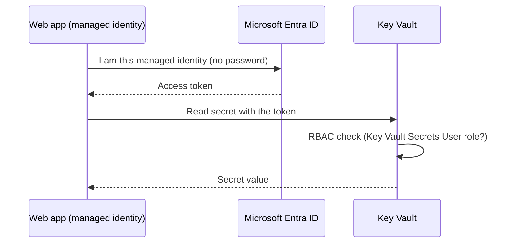

# Lab 3. Azure Key Vault + Managed Identity

🇺🇸 English | [🇰🇷 한국어](README.md) | [← Home](../../README.en.md) | [← Lab 2](../02-functions/README.en.md) | [Next: Lab 4 →](../04-rbac-entra/README.en.md)

⏱ 25 min · 💸 Cents · 🎯 **Internalize "never put credentials in code" by doing it.**
📌 Prerequisite: [Lab 1](../01-app-service/README.en.md) completed (web app required)

## Concept first

Passwords in code, config files or Git eventually leak. The fix combines two things:

- **Key Vault**: a vault for secrets, keys and certificates, with access logging.
- **Managed identity**: a **Microsoft Entra ID identity** attached to an Azure resource (web app, etc.). It has no password; Azure issues and rotates tokens for you.



You'll try **both ways** an app can read a secret:

| Method | Code change | Notes |
|--------|-------------|-------|
| A. **Key Vault reference** (app setting) | None (reads an env var) | Easiest; picks up secret changes automatically |
| B. **SDK + `DefaultAzureCredential`** | Key Vault client code | Full control; same code locally (`az login`) and on Azure (managed identity) |

## 1. Create a Key Vault (RBAC mode)

```bash
source scripts/env.sh
az keyvault create -g $RG -n $KV -l $LOCATION --enable-rbac-authorization true --tags $LAB_TAG -o none
KV_ID=$(az keyvault show -g $RG -n $KV --query id -o tsv)
```

## 2. Store a secret: fail first 💥

Even as subscription Owner you have no access to the **data (secrets)**. *Management* and *data* permissions are separate.

```bash
az keyvault secret set --vault-name $KV -n demo-secret --value "my-super-secret-value"
```

A `Forbidden ... does not have secrets set permission` error is expected. Now grant yourself a role:

```bash
ME=$(az ad signed-in-user show --query id -o tsv)
az role assignment create --assignee-object-id $ME --assignee-principal-type User \
  --role "Key Vault Secrets Officer" --scope $KV_ID -o none
```

It takes 1-2 minutes to take effect. Retry until it works:

```bash
until az keyvault secret set --vault-name $KV -n demo-secret --value "my-super-secret-value" -o none 2>/dev/null; do echo "waiting for permission to propagate..."; sleep 15; done
echo "✅ secret stored"
```

## 3. Enable the web app's managed identity, grant least privilege

```bash
PRINCIPAL_ID=$(az webapp identity assign -g $RG -n $WEBAPP --query principalId -o tsv)
echo $PRINCIPAL_ID

az role assignment create --assignee-object-id $PRINCIPAL_ID --assignee-principal-type ServicePrincipal \
  --role "Key Vault Secrets User" --scope $KV_ID -o none
```

> `Key Vault Secrets User` can only **read** secrets. The app needs no write/delete rights. That's least privilege.

## 4. Method A: Key Vault reference (no code)

```bash
az webapp config appsettings set -g $RG -n $WEBAPP -o none --settings \
  "SECRET_FROM_REFERENCE=@Microsoft.KeyVault(VaultName=$KV;SecretName=demo-secret)"
az webapp restart -g $RG -n $WEBAPP
```

Check after a moment (you may see `unresolved` first because of role propagation and restart; retry in 1-2 minutes):

```bash
URL="https://$(az webapp show -g $RG -n $WEBAPP --query defaultHostName -o tsv)"
curl -s $URL/secret/reference
# {"secret":"my**************** (length=21)","status":"ok"}
```

The app code (`app.py`) has neither Key Vault code nor a password. It only reads the env var `SECRET_FROM_REFERENCE`. App Service fetched the value with the managed identity and injected it.

> In the portal: web app → **Environment variables** → a **Key Vault reference ✔** next to `SECRET_FROM_REFERENCE`.

## 5. Method B: SDK + managed identity

```bash
az webapp config appsettings set -g $RG -n $WEBAPP -o none --settings \
  "KEY_VAULT_URL=https://$KV.vault.azure.net/" "KEY_VAULT_SECRET_NAME=demo-secret"
curl -s $URL/secret/sdk
```

Core code (`src/webapp/app.py`):

```python
client = SecretClient(vault_url=vault_url, credential=DefaultAzureCredential())
secret = client.get_secret(name)
```

`DefaultAzureCredential` automatically uses the **managed identity** on Azure and your `az login` account in Codespaces. Try it locally:

```bash
cd src/webapp
KEY_VAULT_URL=https://$KV.vault.azure.net/ python app.py &   # run in background
sleep 3; curl -s localhost:8000/secret/sdk; kill %1; cd ../..
```

## 6. What if we remove the permission? 🔬

```bash
az role assignment delete --assignee $PRINCIPAL_ID --role "Key Vault Secrets User" --scope $KV_ID
```

After a few minutes `curl -s $URL/secret/sdk` returns a `Forbidden` (403) error. Key Vault checks permissions on **every request**, so you can revoke access instantly without touching code. Restore it afterwards (Lab 4 needs it):

```bash
az role assignment create --assignee-object-id $PRINCIPAL_ID --assignee-principal-type ServicePrincipal \
  --role "Key Vault Secrets User" --scope $KV_ID -o none
```

## 7. (Optional) Do the same for the function app — if you completed Lab 2

```bash
FUNC_PID=$(az functionapp identity assign -g $RG -n $FUNCAPP --query principalId -o tsv)
az role assignment create --assignee-object-id $FUNC_PID --assignee-principal-type ServicePrincipal \
  --role "Key Vault Secrets User" --scope $KV_ID -o none
az functionapp config appsettings set -g $RG -n $FUNCAPP -o none --settings \
  "SECRET_FROM_REFERENCE=@Microsoft.KeyVault(VaultName=$KV;SecretName=demo-secret)"
# after 1-2 minutes
KEY=$(az functionapp keys list -g $RG -n $FUNCAPP --query functionKeys.default -o tsv)
curl -s "https://$(az functionapp show -g $RG -n $FUNCAPP --query defaultHostName -o tsv)/api/secret" -H "x-functions-key: $KEY"
```

## ❓ Quiz

1. Where did **you type a password/key** in this lab? (Not for the managed identity!)
2. Why couldn't an Owner read the secret? (management plane vs data plane)
3. If the secret changes often, which method is more convenient, A or B?

## 🛠 Troubleshooting

| Symptom | Fix |
|---------|-----|
| `az ad signed-in-user show` fails (guest/personal account) | `ME=$(az ad user show --id "$(az account show --query user.name -o tsv)" --query id -o tsv)` |
| `/secret/reference` says `unresolved` | Check identity and role (step 3) → `az webapp restart` → wait 2 minutes. Check the reference status under Environment variables in the portal |
| `/secret/sdk` says `Forbidden` | Verify the role from step 3; wait for propagation (up to ~5 min) |
| Key Vault name conflict / deleted name | `az keyvault purge --name $KV` or use a new suffix |

> ⚠️ In production also enable Key Vault **purge protection** and network restrictions (Private Endpoint). This lab leaves them off to keep cleanup simple.

➡️ Next: [Lab 4. RBAC & Microsoft Entra ID](../04-rbac-entra/README.en.md)
