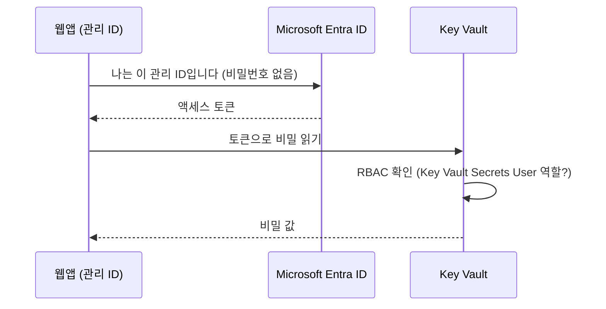

# 실습 3. Azure Key Vault + 관리 ID(Managed Identity)

[🇺🇸 English](README.en.md) | 🇰🇷 한국어 | [← 처음으로](../../README.md) | [← 실습 2](../02-functions/README.md) | [다음: 실습 4 →](../04-rbac-entra/README.md)

⏱ 25분 · 💸 센트 단위 · 🎯 **"자격 증명을 코드에 넣지 않는다"** 원칙을 직접 체득합니다.
📌 사전 조건: [실습 1](../01-app-service/README.md) 완료 (웹앱 필요)

## 개념 먼저

비밀번호를 코드·설정 파일·Git에 넣으면 유출됩니다. 해결책은 두 가지를 조합하는 것입니다.

- **Key Vault**: 비밀(secret)·키·인증서를 보관하는 금고. 접근 기록이 남습니다.
- **관리 ID(Managed Identity)**: Azure 리소스(웹앱 등)에 붙는 **Microsoft Entra ID 신원**. 비밀번호가 없고 Azure가 토큰을 대신 발급·갱신합니다.



이 실습에서 앱이 비밀을 읽는 **두 가지 방법**을 모두 해 봅니다.

| 방법 | 코드 변경 | 특징 |
|------|-----------|------|
| A. **Key Vault 참조** (앱 설정) | 없음 (환경변수로 읽음) | 가장 쉬움. 비밀이 바뀌면 자동 반영 |
| B. **SDK + `DefaultAzureCredential`** | Key Vault 호출 코드 | 코드가 직접 제어. 로컬(`az login`)·Azure(관리 ID) 모두 같은 코드 |

## 1. Key Vault 만들기 (RBAC 모드)

```bash
source scripts/env.sh
az keyvault create -g $RG -n $KV -l $LOCATION --enable-rbac-authorization true --tags $LAB_TAG -o none
KV_ID=$(az keyvault show -g $RG -n $KV --query id -o tsv)
```

## 2. 비밀 저장 — 먼저 실패해 봅시다 💥

구독 Owner 인 나도 **데이터(비밀)** 에는 권한이 없습니다. *관리 권한*과 *데이터 권한*은 분리되어 있습니다.

```bash
az keyvault secret set --vault-name $KV -n demo-secret --value "my-super-secret-value"
```

`Forbidden ... does not have secrets set permission` 오류가 나면 정상입니다. 내게 역할을 부여합니다.

```bash
ME=$(az ad signed-in-user show --query id -o tsv)
az role assignment create --assignee-object-id $ME --assignee-principal-type User \
  --role "Key Vault Secrets Officer" --scope $KV_ID -o none
```

역할이 적용되기까지 1~2분 걸립니다. 성공할 때까지 반복합니다.

```bash
until az keyvault secret set --vault-name $KV -n demo-secret --value "my-super-secret-value" -o none 2>/dev/null; do echo "권한 전파 대기 중..."; sleep 15; done
echo "✅ 비밀 저장됨"
```

## 3. 웹앱에 관리 ID 켜고, 최소 권한 부여

```bash
PRINCIPAL_ID=$(az webapp identity assign -g $RG -n $WEBAPP --query principalId -o tsv)
echo $PRINCIPAL_ID

az role assignment create --assignee-object-id $PRINCIPAL_ID --assignee-principal-type ServicePrincipal \
  --role "Key Vault Secrets User" --scope $KV_ID -o none
```

> `Key Vault Secrets User` 는 비밀을 **읽기만** 할 수 있는 역할입니다. 앱에 쓰기/삭제 권한은 필요 없으니까요. 이게 최소 권한입니다.

## 4. 방법 A — Key Vault 참조 (코드 없이)

```bash
az webapp config appsettings set -g $RG -n $WEBAPP -o none --settings \
  "SECRET_FROM_REFERENCE=@Microsoft.KeyVault(VaultName=$KV;SecretName=demo-secret)"
az webapp restart -g $RG -n $WEBAPP
```

잠시 후 확인합니다. (역할 전파·재시작 때문에 `unresolved` 가 먼저 나올 수 있습니다. 1~2분 뒤 재시도)

```bash
URL="https://$(az webapp show -g $RG -n $WEBAPP --query defaultHostName -o tsv)"
curl -s $URL/secret/reference
# {"secret":"my**************** (length=21)","status":"ok"}
```

앱 코드(`app.py`)에는 Key Vault 도, 비밀번호도 없습니다. 환경변수 `SECRET_FROM_REFERENCE` 만 읽습니다. App Service가 관리 ID로 Key Vault에서 값을 가져와 주입한 것입니다.

> 포털에서 확인: 웹앱 → **환경 변수** → `SECRET_FROM_REFERENCE` 옆의 **Key Vault 참조 ✔**

## 5. 방법 B — SDK + 관리 ID

```bash
az webapp config appsettings set -g $RG -n $WEBAPP -o none --settings \
  "KEY_VAULT_URL=https://$KV.vault.azure.net/" "KEY_VAULT_SECRET_NAME=demo-secret"
curl -s $URL/secret/sdk
```

핵심 코드 (`src/webapp/app.py`):

```python
client = SecretClient(vault_url=vault_url, credential=DefaultAzureCredential())
secret = client.get_secret(name)
```

`DefaultAzureCredential` 은 Azure에서는 **관리 ID**, Codespaces에서는 `az login` 계정을 자동으로 사용합니다. 로컬에서도 확인해 보세요.

```bash
cd src/webapp
KEY_VAULT_URL=https://$KV.vault.azure.net/ python app.py &   # 백그라운드 실행
sleep 3; curl -s localhost:8000/secret/sdk; kill %1; cd ../..
```

## 6. 권한을 빼면 어떻게 될까? 🔬

```bash
az role assignment delete --assignee $PRINCIPAL_ID --role "Key Vault Secrets User" --scope $KV_ID
```

몇 분 뒤 `curl -s $URL/secret/sdk` 가 `Forbidden` (403) 오류를 반환합니다. **권한은 Key Vault가 매 요청마다 확인**하므로 코드를 건드리지 않고 접근을 즉시 회수할 수 있습니다. 실습 4에서 다시 부여하니 확인했다면 복구하세요.

```bash
az role assignment create --assignee-object-id $PRINCIPAL_ID --assignee-principal-type ServicePrincipal \
  --role "Key Vault Secrets User" --scope $KV_ID -o none
```

## 7. (선택) 함수 앱에도 똑같이 — 실습 2를 완료한 경우

```bash
FUNC_PID=$(az functionapp identity assign -g $RG -n $FUNCAPP --query principalId -o tsv)
az role assignment create --assignee-object-id $FUNC_PID --assignee-principal-type ServicePrincipal \
  --role "Key Vault Secrets User" --scope $KV_ID -o none
az functionapp config appsettings set -g $RG -n $FUNCAPP -o none --settings \
  "SECRET_FROM_REFERENCE=@Microsoft.KeyVault(VaultName=$KV;SecretName=demo-secret)"
# 1~2분 후
KEY=$(az functionapp keys list -g $RG -n $FUNCAPP --query functionKeys.default -o tsv)
curl -s "https://$(az functionapp show -g $RG -n $FUNCAPP --query defaultHostName -o tsv)/api/secret" -H "x-functions-key: $KEY"
```

## ❓ 점검 퀴즈

1. 이 실습에서 **비밀번호/키를 입력한 곳**은 어디인가요? (관리 ID에는 없습니다)
2. Owner 인데 비밀을 못 읽은 이유는? (관리 평면 vs 데이터 평면)
3. 방법 A와 B 중 비밀이 자주 바뀌는 경우 더 편한 것은?

## 🛠 문제 해결

| 증상 | 해결 |
|------|------|
| `az ad signed-in-user show` 실패 (게스트/개인 계정) | `ME=$(az ad user show --id "$(az account show --query user.name -o tsv)" --query id -o tsv)` |
| `/secret/reference` 가 `unresolved` | 관리 ID·역할 부여 확인 → `az webapp restart` → 2분 대기. 포털 환경 변수에서 참조 상태 확인 |
| `/secret/sdk` 가 `Forbidden` | 3단계 역할 부여 확인, 전파 대기 (최대 약 5분) |
| `Public network access is disabled ... ForbiddenByConnection` (비밀 저장·읽기) | 역할 문제가 아니라 조직 정책이 Key Vault 의 공용 네트워크 접근을 꺼 둔 경우입니다. 정책이 없는 **개인 실습용 구독**에서 진행하세요 |
| 키 볼트 이름 충돌 / 삭제된 이름 | `az keyvault purge --name $KV` 또는 새 접미사 |

> ⚠️ 실제 운영에서는 Key Vault 의 **삭제 방지(purge protection)** 와 네트워크 제한(Private Endpoint)도 켜세요. 이 랩은 정리를 쉽게 하려고 켜지 않았습니다.

➡️ 다음: [실습 4. RBAC & Microsoft Entra ID](../04-rbac-entra/README.md)
