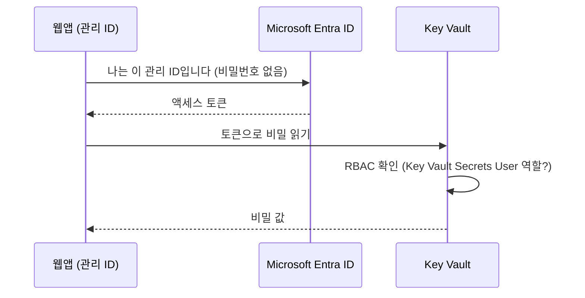

# 실습 3. Azure Key Vault + 관리 ID(Managed Identity)

[🇺🇸 English](README.en.md) | 🇰🇷 한국어 | [← 처음으로](../../README.md) | [← 실습 2](../02-functions/README.md) | [다음: 실습 4 →](../04-rbac-entra/README.md)

⏱ 25~35분 · 💸 B1 + Private Endpoint 시간당 과금 · 🎯 **"자격 증명을 코드에 넣지 않는다"** 원칙을 직접 체득합니다.
📌 사전 조건: [실습 1](../01-app-service/README.md) 완료 (웹앱 필요)

## 개념 먼저

비밀번호를 코드·설정 파일·Git에 넣으면 유출됩니다. 해결책은 두 가지를 조합하는 것입니다.

- **Key Vault**: 비밀(secret)·키·인증서를 보관하는 금고. 접근 기록이 남습니다.
- **관리 ID(Managed Identity)**: Azure 리소스(웹앱 등)에 붙는 **Microsoft Entra ID 신원**. 비밀번호가 없고 Azure가 토큰을 대신 발급·갱신합니다.
- **Private Endpoint**: 비밀을 읽는 네트워크 경로를 VNet 내부로 제한합니다. **네트워크 접근**과 **RBAC 권한**이 모두 있어야 비밀을 읽을 수 있습니다.



이 실습에서 앱이 비밀을 읽는 **두 가지 방법**을 모두 해 봅니다.

| 방법 | 코드 변경 | 특징 |
|------|-----------|------|
| A. **Key Vault 참조** (앱 설정) | 없음 (환경변수로 읽음) | 가장 쉬움. 비밀이 바뀌면 자동 반영 |
| B. **SDK + `DefaultAzureCredential`** | Key Vault 호출 코드 | 코드가 직접 제어. 로컬(`az login`)·Azure(관리 ID) 모두 같은 코드 |

## 1. 준비 — 명령 한 줄

```bash
bash scripts/03-key-vault.sh --allow-paid
```

`--allow-paid`는 유료 리소스 사용 동의입니다. F1 웹앱을 **VNet 통합이 가능한 B1**으로 바꾸고, 비공개 Key Vault·Private DNS·Private Endpoint·관리 ID·읽기 역할을 준비합니다. 조직 정책이나 공용 접근 설정을 완화하지 않습니다.

```text
내 HTTPS 요청 → 웹앱(B1) → VNet → Private Endpoint → Key Vault(공용 접근 Disabled)
                       └─ 관리 ID + Key Vault Secrets User ─┘
```

스크립트는 공개된 데모 값 `my-super-secret-value`를 **ARM 관리 평면**으로 저장합니다. 실제 비밀번호를 코드나 이 명령에 넣지 마세요. 데이터 평면에서 비밀을 읽는 것은 별도의 네트워크·RBAC 검사를 받습니다.

## 2. 관리 ID와 최소 권한 확인

```bash
source scripts/env.sh
KV_ID=$(az keyvault show -g $RG -n $KV --query id -o tsv)
PRINCIPAL_ID=$(az webapp identity show -g $RG -n $WEBAPP --query principalId -o tsv)
az keyvault show -g $RG -n $KV --query properties.publicNetworkAccess -o tsv
az webapp show -g $RG -n $WEBAPP --query virtualNetworkSubnetId -o tsv
az role assignment list --scope $KV_ID \
  --query "[?principalId=='$PRINCIPAL_ID'].roleDefinitionName" -o tsv
```

`Disabled`, 서브넷 ID, `Key Vault Secrets User`가 나오면 정상입니다. 앱에는 **금고 범위에서 읽기만** 허용합니다. 쓰기·삭제나 구독 전체 권한은 필요 없습니다.

## 3. 방법 A — Key Vault 참조 (SDK 호출 없이)

스크립트가 앱 설정에 `@Microsoft.KeyVault(VaultName=...;SecretName=demo-secret)`를 넣었습니다. 웹앱 플랫폼이 관리 ID로 값을 가져와 환경변수로 주입합니다.

스크립트가 웹앱의 HTTP 기동까지 기다립니다. 역할·DNS 전파 때문에 처음에는 `unresolved`가 나올 수 있습니다. 1~2분 뒤 재시도하세요. 첫 SDK 요청은 토큰 발급 때문에 더 느릴 수 있습니다.

```bash
URL="https://$(az webapp show -g $RG -n $WEBAPP --query defaultHostName -o tsv)"
curl -i $URL/secret/reference
# {"secret":"my******************* (length=21)","status":"ok"}
```

이 경로의 앱 코드(`app.py`)는 환경변수 `SECRET_FROM_REFERENCE`만 읽고 Key Vault SDK를 호출하지 않습니다. 응답은 비밀 원문 대신 마스킹된 값입니다.

> 포털에서 확인: 웹앱 → **환경 변수** → `SECRET_FROM_REFERENCE` 옆의 **Key Vault 참조 ✔**

## 4. 방법 B — SDK + 관리 ID

```bash
curl -i $URL/secret/sdk
```

핵심 코드 (`src/webapp/app.py`):

```python
client = SecretClient(vault_url=vault_url, credential=DefaultAzureCredential())
secret = client.get_secret(name)
```

HTTP 200과 마스킹된 비밀이 나오면 **관리 ID 인증 + RBAC 권한 + 비공개 네트워크 경로**를 모두 확인한 것입니다. `DefaultAzureCredential`은 이 웹앱에서는 관리 ID를 선택합니다.

> 로컬/Codespaces는 이 VNet 밖에 있으므로 SDK나 `az keyvault secret show`로 직접 읽으면 `Forbidden`이 정상입니다. 공용 접근을 켜지 말고 배포된 웹앱을 통해 확인하세요. Owner의 관리 권한도 비밀 읽기 데이터 권한을 자동으로 주지는 않습니다.

## 5. 권한을 빼면 어떻게 될까? 🔬

```bash
az role assignment delete --assignee $PRINCIPAL_ID --role "Key Vault Secrets User" --scope $KV_ID
```

역할 변경이 전파된 뒤 `curl -i $URL/secret/sdk`가 HTTP 403을 반환합니다. **네트워크는 그대로인데 권한만 빼도 실패**합니다. RBAC 캐시 때문에 즉시 반영되지는 않을 수 있으므로 잠시 기다리세요. 앱 설정 참조에도 캐시가 있어 이 실험은 SDK 경로로 합니다. 확인했다면 실습 4를 위해 복구하세요.

```bash
az role assignment create --assignee-object-id $PRINCIPAL_ID --assignee-principal-type ServicePrincipal \
  --role "Key Vault Secrets User" --scope $KV_ID -o none
```

## 6. (선택) 함수 앱에도 똑같이 — 실습 2를 완료한 경우

```bash
FUNC_PID=$(az functionapp identity assign -g $RG -n $FUNCAPP --query principalId -o tsv)
az role assignment create --assignee-object-id $FUNC_PID --assignee-principal-type ServicePrincipal \
  --role "Key Vault Secrets User" --scope $KV_ID -o none
az functionapp config appsettings set -g $RG -n $FUNCAPP -o none --settings \
  "SECRET_FROM_REFERENCE=@Microsoft.KeyVault(VaultName=$KV;SecretName=demo-secret)"
# 1~2분 후
KEY=$(az functionapp keys list -g $RG -n $FUNCAPP --query functionKeys.default -o tsv)
HOST=$(az functionapp show -g $RG -n $FUNCAPP --query "properties.defaultHostName || defaultHostName" -o tsv)
curl -i "https://$HOST/api/secret" -H "x-functions-key: $KEY"
unset KEY
```

함수도 웹앱과 동일하게 설정 누락은 HTTP 404, 참조 해석 실패는 HTTP 502, 성공은 HTTP 200으로 응답합니다.

## ❓ 점검 퀴즈

1. 이 실습에서 **비밀번호/키를 입력한 곳**은 어디인가요? (관리 ID에는 없습니다)
2. Owner 인데 비밀을 못 읽은 이유는? (관리 평면 vs 데이터 평면)
3. 방법 A와 B 중 비밀이 자주 바뀌는 경우 더 편한 것은?

## 🛠 문제 해결

| 증상 | 해결 |
|------|------|
| `--allow-paid` 없이 스크립트 실행 | B1과 Private Endpoint 비용을 확인한 뒤 해당 옵션으로 실행 |
| `/secret/reference` 가 `unresolved` | 관리 ID·역할 부여 확인 → `az webapp restart` → 2분 대기. 포털 환경 변수에서 참조 상태 확인 |
| 웹앱 `/secret/sdk`가 `ForbiddenByRbac` | 금고 범위의 관리 ID 읽기 역할 확인, 역할 전파 대기 |
| 웹앱 `/secret/sdk`가 `ForbiddenByConnection` | `bash scripts/03-key-vault.sh --allow-paid`의 VNet/DNS/Private Endpoint 설정 확인. 로컬 터미널에서 직접 읽을 때는 이 오류가 정상 |
| 키 볼트 이름 충돌 / 삭제된 이름 | `az keyvault purge --name $KV` 또는 새 접미사 |

> ⚠️ 네트워크 제한은 이미 적용했습니다. 실제 운영에서는 **삭제 방지(purge protection)**도 켜세요. 이 랩은 정리를 위해 삭제 방지만 꺼 둡니다. B1과 Private Endpoint는 사용하지 않아도 과금되므로 마지막에 꼭 정리하세요.

➡️ 다음: [실습 4. RBAC & Microsoft Entra ID](../04-rbac-entra/README.md)
